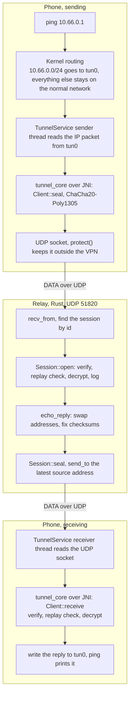
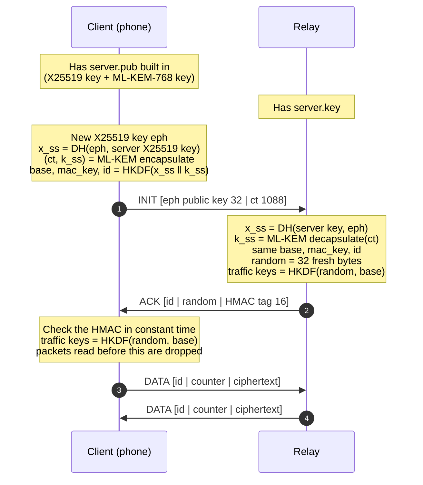
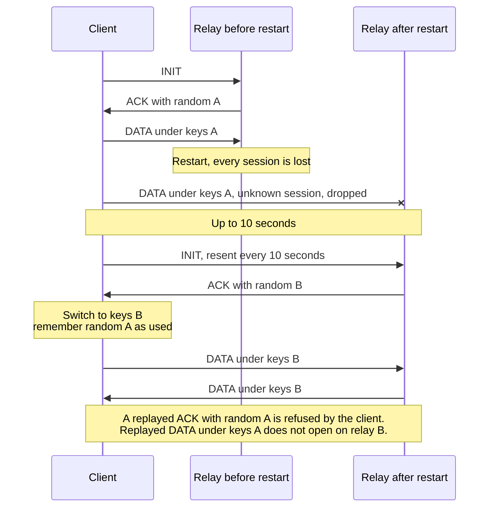
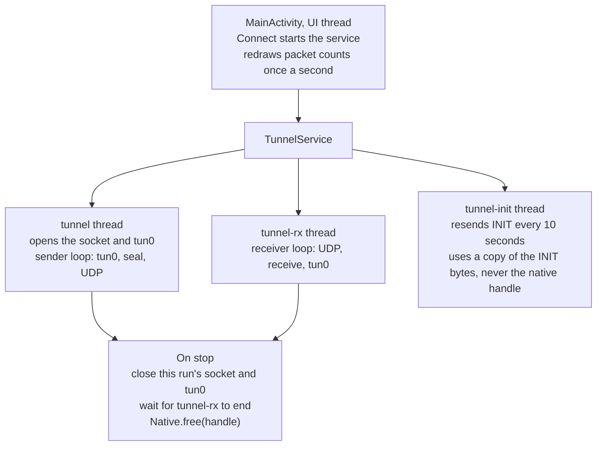

# pq-tunnel-demo

A small Android VPN app whose tunnel crypto is written in Rust: a hybrid **X25519 + ML-KEM-768**
handshake and ChaCha20-Poly1305 packets, called from Kotlin over JNI. It is a study of the pieces a
mobile [PQConnect](https://www.pqconnect.net) client needs (a system VPN interface, a Rust core
behind FFI, post-quantum key exchange), not a replacement for it.

**Illustrated walkthrough:** [PQ Tunnel Demo](https://claude.ai/artifact/QLeFTQXhSWSMBAYYZShGiq): the
path of one ping, the handshake, why the relay adds a random, and the packets drawn to scale.

### The path of one ping



## Contents

- [Layout](#layout)
- [Protocol](#protocol)
- [Design decisions](#design-decisions)
- [Known limits](#known-limits)
- [Run it](#run-it)
- [Tests and verification](#tests-and-verification)
- [Specs (OpenSpec)](#specs-openspec)
- [Next](#next)

## Layout

| Path | What it is |
|---|---|
| `core/` | Rust crate `tunnel_core`: handshake, ACK, AEAD packets, replay window, JNI bindings (`src/android.rs`) |
| `relay/` | Rust UDP server: key generation, session table, ICMP echo for the gateway |
| `android/` | Kotlin app: `VpnService`, a one-screen UI, Gradle tasks that cross-compile the Rust core |
| `openspec/specs/` | Requirements and scenarios for each part; the source of truth for behavior |
| `openspec/changes/archive/` | Past changes with their proposal, design and task list |

## Protocol

The client pins the server's public keys (X25519 key + ML-KEM-768 encapsulation key, 1216 bytes)
and sends INIT. The relay answers with ACK; data flows after that one round trip.

```
INIT  [0x01][client ephemeral X25519 pub, 32][ML-KEM-768 ciphertext, 1088]
ACK   [0x03][session id, 8][server random, 32][HMAC-SHA256 tag, 16]
DATA  [0x02][session id, 8][counter, 8][ChaCha20-Poly1305 ciphertext + tag]
```



1. **Handshake secrets.** `HKDF-SHA256(salt = "pq-tunnel-demo v2", ikm = X25519 secret ‖ ML-KEM
   secret, info = SHA-256(INIT body ‖ server public keys))` gives a base secret, an ACK MAC key and
   the session id. Reading traffic requires breaking **both** X25519 and ML-KEM. Hashing the INIT
   and the server keys into `info` stops two different handshakes from agreeing on one key.
2. **ACK.** For every session it opens, the relay picks 32 random bytes and sends them with the
   first 16 bytes of `HMAC-SHA256(ACK MAC key, type ‖ session id ‖ random)`. The client checks the
   tag in constant time, so it knows it talks to the holder of the server's private keys before it
   sends anything.
3. **Traffic keys.** `HKDF-SHA256(salt = server random, ikm = base secret, info = "traffic")`, one
   key per direction.
4. **DATA.** The 17-byte header is the AEAD associated data; the nonce is four zero bytes followed
   by the counter. Each side increases its counter by one per packet.
5. **Replay window.** The receiver accepts each counter once, accepts reordering within 64 counters
   of the highest one seen, and refuses anything older. Only packets that authenticate move the
   window, so a forged packet cannot block the real one.

### How the tunnel heals



| Event | What happens |
|---|---|
| INIT lost | The client resends INIT every 10 seconds for the life of the connection. |
| INIT repeated (client retry, or an attacker replaying a recording) | The relay sends the ACK it sent the first time and keeps the session, replay window included. |
| Relay restarted | It has no sessions. The next INIT resend opens a new one with a new random, so new keys; the client switches to them. Packets recorded before the restart do not open. |
| Old ACK replayed after a restart | The client remembers every random it has used and refuses it, so it cannot be switched back to old keys. |
| Phone switches networks | Sessions are keyed by id, not address; the relay replies to the latest source address. A send that fails during the switch drops that one packet, not the tunnel. |

## Design decisions

The full reasoning, with the alternatives that were rejected, is in
[`openspec/changes/archive/2026-10-29-harden-tunnel/design.md`](openspec/changes/archive/2026-10-29-harden-tunnel/design.md).
The short version:

- **A server random per session.** The first version derived every key from the INIT alone. A
  relay restarted with the same key, answering the same INIT, then derived the same keys with
  counters back at 0, and encrypted new packets under a key and nonce it had already used. With
  ChaCha20-Poly1305 that leaks the XOR of the two plaintexts and allows forgeries. Mixing in a
  random the relay picks per session makes every relay process derive new keys.
- **HMAC for the ACK, not the AEAD.** A restarted relay signs a second ACK for the same INIT. An
  AEAD key derived from the INIT would be used twice with the same nonce; HMAC has no nonce.
- **Repeated INIT returns the original ACK.** A fresh session would start with an empty replay
  window and accept recorded packets again.
- **Native handle lifetime.** Kotlin holds the Rust session as an opaque `Long`. Each connection
  frees it only after both packet loops have ended, closes only the socket and interface it created,
  and the INIT resend thread copies the INIT bytes so it never touches the handle.
- **Build checks that cannot be skipped.** The `keys/server.pub` check runs in `preBuild`, because
  Gradle skips a Copy task with no source files, actions included. `cargo` is looked up in
  `~/.cargo/bin` and `/opt/homebrew/opt/rustup/bin`, because Android Studio started from the Dock
  gets a PATH without Rust.

### Inside the app



## Known limits

On purpose, for a demo:

- **No forward secrecy against theft of the server's long-term key.** The server random is sent in
  the clear and the server contributes no ephemeral key, so whoever steals `server.key` can derive
  recorded sessions. A real protocol (PQConnect included) adds a server ephemeral key and rekeys.
- **Anonymous clients.** The relay accepts anyone who knows its public key.
- **No forwarding.** The relay only answers pings to 10.66.0.1. A real relay writes packets to a TUN
  device and NATs them.
- **Sessions never expire**, and each INIT resend costs the relay one ML-KEM decapsulation. Fine for
  a demo; a real relay drops idle sessions and caches INITs or uses a cookie.
- **Keys at build time.** `keys/server.pub` is packed into the APK, where PQConnect publishes keys
  in DNS.

## Run it

Needs Rust (with the `aarch64-linux-android` and `x86_64-linux-android` targets), `cargo-ndk`,
JDK 17, and the Android SDK with NDK 27.

Run the tests:

```bash
cargo test
```

Generate the server keys once. `server.key` gets mode 600, and a second run refuses to overwrite
it, because apps built with the old public key would stop working. `keys/` is in `.gitignore`.

```bash
cargo run -p relay -- keygen keys
```

Start the relay:

```bash
cargo run -p relay -- serve keys 0.0.0.0:51820
```

Build and install the app on a running emulator or device. Gradle cross-compiles the Rust core
first, and stops with a hint if `keys/server.pub` is missing.

```bash
cd android && ./gradlew installDebug
```

Open **PQ Tunnel Demo**, keep the default relay `10.0.2.2:51820` (the host machine as seen from the
emulator), tap **Connect**, allow the VPN, then ping the gateway from the device:

```bash
adb shell ping -c 3 10.66.0.1
```

The relay logs each decrypted packet, and the app shows packets sent and received. On a real phone,
use the LAN address of the machine running the relay. Only 10.66.0.0/24 goes through the tunnel;
the rest of the phone's traffic is untouched.

## Tests and verification

`cargo test` runs 17 tests, each named after the spec scenario it covers.

- **Core (10):** round trips in both directions, no data before the ACK, key save/load, ACKs from
  the wrong server or with a forged MAC, a restarted server that must derive new keys and must not
  be switched back, tampered packets, replay and reordering, the window edge, malformed handshakes.
- **Relay (7):** over real UDP sockets, an end-to-end ping, a replayed INIT that must not reopen
  recorded packets, replies to a client's new address, and recovery after a relay restart; plus
  ICMP checksums, pings to other addresses, and IP headers too short to read.

The Android app has no automated tests. It was checked by hand on an API 32 arm64 emulator:

| Check | Result |
|---|---|
| Relay `10.0.2.2:` | "Bad relay address", app keeps running |
| Connect, `ping -c 3 10.66.0.1` | `tun0` has 10.66.0.2, 3 of 3 answered |
| Restart the relay, wait 11 seconds, ping | 3 of 3 answered, no user action |
| Tap Connect twice, ping | "Connected", 3 of 3 answered |
| Disconnect | `tun0` removed, "Disconnected", no crash in logcat |
| Build a copy without `keys/`, PATH `/usr/bin:/bin:/usr/sbin:/sbin` | Rust core compiles, build stops with the keygen hint |

Not reproduced: a failed send during a network switch (the emulator does not make `send` fail).

## Specs (OpenSpec)

Behavior is specified with [OpenSpec](https://github.com/Fission-AI/OpenSpec) in
`openspec/specs/`, one folder per capability:

| Spec | Covers |
|---|---|
| [`tunnel-protocol`](openspec/specs/tunnel-protocol/spec.md) | INIT, handshake secrets, ACK, traffic keys, DATA, replay window |
| [`relay`](openspec/specs/relay/spec.md) | key generation, sessions and repeated INITs, reply addresses, packet parsing |
| [`android-client`](openspec/specs/android-client/spec.md) | VPN routes, input errors, self-healing, connection lifecycle, counters, build |

Each requirement has scenarios (WHEN / THEN), and each Rust test is named after one. Changes go
through `openspec/changes/<name>/` (proposal, design, tasks, spec deltas) and are archived when
done. With OpenSpec installed:

```bash
openspec validate --specs --strict
```

## Next

- iOS: the same `tunnel_core` behind a Swift `NEPacketTunnelProvider` (needs a paid Apple developer
  account for the Network Extension entitlement on devices).
- A server ephemeral key and rekeying; key discovery over DNS.

## License

MIT
