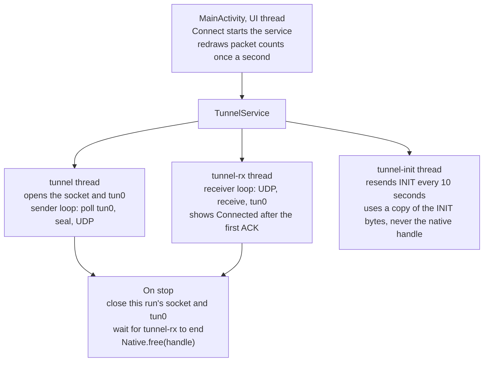

# pq-tunnel-demo

A small Android VPN app whose tunnel crypto is written in Rust: a hybrid **X25519 + ML-KEM-768**
handshake and ChaCha20-Poly1305 packets, called from Kotlin over JNI. It is a study of the pieces a
mobile [PQConnect](https://www.pqconnect.net) client needs (a system VPN interface, a Rust core
behind FFI, post-quantum key exchange), not a replacement for it.

### The path of one ping


Shaded boxes are where the crypto runs. Only 10.66.0.0/24 is routed into the VPN interface; the
phone's own UDP socket is excluded with `protect()`, so sealed packets do not loop back into the
tunnel. The relay answers only pings to the gateway 10.66.0.1 and forwards nothing to the internet.

## Contents

- [Layout](#layout)
- [What is real, what is simplified](#what-is-real-what-is-simplified)
- [Protocol](#protocol)
- [Design decisions](#design-decisions)
- [Known limits](#known-limits)
- [Run it](#run-it)
- [Tests and verification](#tests-and-verification)
- [Specs (OpenSpec)](#specs-openspec)
- [Next](#next)

## Layout

| Path | What it is |
|---|---|
| `core/` | Rust crate `tunnel_core`: handshake, ACK, AEAD packets, replay window, JNI bindings (`src/android.rs`) |
| `relay/` | Rust UDP server: key generation, session table, ICMP echo for the gateway |
| `android/` | Kotlin app: `VpnService`, a one-screen UI, Gradle tasks that cross-compile the Rust core |
| `docs/diagrams/` | The SVG diagrams in this README (self-contained, light and dark) |
| `openspec/specs/` | Requirements and scenarios for each part; the source of truth for behavior |
| `openspec/changes/archive/` | Past changes with their proposal, design and task list |

## What is real, what is simplified

| Real | Simplified |
|---|---|
| ML-KEM-768 (NIST FIPS 203) from RustCrypto's `ml-kem`, run on every connect | The protocol is this demo's own, not PQConnect's |
| X25519, HKDF-SHA256, HMAC-SHA256, ChaCha20-Poly1305 | No forward secrecy if the server's long-term key is stolen |
| Android `VpnService` with a real tun interface and routes | Clients are anonymous; sessions never expire |
| Rust core cross-compiled for arm64 and x86_64, called over JNI | The relay answers pings to 10.66.0.1 and forwards nothing else |
| 21 Rust tests, 7 JVM tests and 9 instrumented Android tests, plus checks by hand on an emulator | Android only; an iOS client would reuse the same Rust core |

## Protocol

The client pins the server's public keys (X25519 key + ML-KEM-768 encapsulation key, 1216 bytes)
and sends INIT. The relay answers with ACK; data flows after that one round trip.

```
INIT  [0x01][client ephemeral X25519 pub, 32][ML-KEM-768 ciphertext, 1088]
ACK   [0x03][session id, 8][server random, 32][HMAC-SHA256 tag, 16]
DATA  [0x02][session id, 8][counter, 8][ChaCha20-Poly1305 ciphertext + tag]
```


Drawn to scale (one byte is 0.68 px). The post-quantum part is almost all of the handshake's size
and costs nothing per packet after it. INIT still fits in one UDP packet on a 1280-byte path.


1. **Handshake secrets.** `HKDF-SHA256(salt = "pq-tunnel-demo v2", ikm = X25519 secret ‖ ML-KEM
   secret, info = SHA-256(INIT body ‖ server public keys))` gives a base secret, an ACK MAC key and
   the session id. Reading traffic requires breaking **both** X25519 and ML-KEM. Hashing the INIT
   and the server keys into `info` stops two different handshakes from agreeing on one key.
2. **ACK.** For every session it opens, the relay picks 32 random bytes and sends them with the
   first 16 bytes of `HMAC-SHA256(ACK MAC key, type ‖ session id ‖ random)`. The client checks the
   tag in constant time, so it knows it talks to the holder of the server's private keys before it
   sends anything.
3. **Traffic keys.** `HKDF-SHA256(salt = server random, ikm = base secret, info = "traffic")`, one
   key per direction.
4. **DATA.** The 17-byte header is the AEAD associated data; the nonce is four zero bytes followed
   by the counter. Each side increases its counter by one per packet.
5. **Replay window.** The receiver accepts each counter once, accepts reordering within 64 counters
   of the highest one seen, and refuses anything older. Only packets that authenticate move the
   window, so a forged packet cannot block the real one.

### How the tunnel heals


The green arrows are what the fix added. The client also remembers every random it has accepted,
so an attacker who replays the old ACK cannot switch it back to the old key and replay recorded
packets.

| Event | What happens |
|---|---|
| INIT lost | The client resends INIT every 10 seconds for the life of the connection. |
| INIT repeated (client retry, or an attacker replaying a recording) | The relay sends the ACK it sent the first time and keeps the session, replay window included. |
| Relay restarted | It has no sessions. The next INIT resend opens a new one with a new random, so new keys; the client switches to them. Packets recorded before the restart do not open. |
| Old ACK replayed after a restart | The client remembers every random it has used and refuses it, so it cannot be switched back to old keys. |
| Phone switches networks | Sessions are keyed by id, not address; the relay replies to the latest source address. A send that fails during the switch drops that one packet, not the tunnel. |

## Design decisions

The full reasoning, with the alternatives that were rejected, is in
[`openspec/changes/archive/2026-10-29-harden-tunnel/design.md`](openspec/changes/archive/2026-10-29-harden-tunnel/design.md).
The short version:

- **A server random per session.** The first version derived every key from the INIT alone. A
  relay restarted with the same key, answering the same INIT, then derived the same keys with
  counters back at 0, and encrypted new packets under a key and nonce it had already used. With
  ChaCha20-Poly1305 that leaks the XOR of the two plaintexts and allows forgeries. Mixing in a
  random the relay picks per session makes every relay process derive new keys.
- **HMAC for the ACK, not the AEAD.** A restarted relay signs a second ACK for the same INIT. An
  AEAD key derived from the INIT would be used twice with the same nonce; HMAC has no nonce.
- **Repeated INIT returns the original ACK.** A fresh session would start with an empty replay
  window and accept recorded packets again.
- **A freed native session cannot be used.** Kotlin holds a numbered handle, not a pointer. The
  Rust side keeps sessions in a table (`core/src/handles.rs`), so a call with a freed or unknown
  handle returns null or false instead of reading freed memory. A use-after-free would crash only
  sometimes, so a test could not reliably catch one; the table makes it impossible instead.
- **No busy loop.** The tun fd from `establish()` is non-blocking (`O_NONBLOCK`, read from
  `/proc/<pid>/fdinfo`), so reading it in a loop spins on empty reads. Measured: 188 clock ticks of
  CPU in 2 idle seconds without a wait, 0 with `Os.poll` and a 500 ms timeout.
- **Stopping that cannot get lost.** Each connection is a `Run` object that a stop marks and closes.
  The run checks the mark after the name lookup, after opening its socket, right before
  `establish()` and right after it. A stop before the check before `establish()` keeps `tun0` from
  coming up; a stop during `establish()` cannot interrupt it, so `tun0` comes up and is closed at
  once. An error caused by the stop is not shown. `stopSelf(startId)` keeps a Connect that arrived
  after a Disconnect.
- **Every native session is freed.** `Native.liveSessions()` counts live sessions, and every
  instrumented test checks that it returns to 0, so a missing `free` fails the suite.
- **The status only claims what the client knows.** "Connected" waits for the relay's ACK; before it
  the screen says "Waiting for the relay". An error that ends a connection stays on screen.
- **Build checks that cannot be skipped.** The `keys/server.pub` check runs first in the Rust build
  task, so a fresh clone fails in seconds. It cannot live in the Copy task: Gradle skips a Copy task
  with no source files, actions included. `cargo` is looked up in
  `~/.cargo/bin` and `/opt/homebrew/opt/rustup/bin`, because Android Studio started from the Dock
  gets a PATH without Rust.

### Inside the app



## Known limits

On purpose, for a demo:

- **No forward secrecy against theft of the server's long-term key.** The server random is sent in
  the clear and the server contributes no ephemeral key, so whoever steals `server.key` can derive
  recorded sessions. A real protocol (PQConnect included) adds a server ephemeral key and rekeys.
- **Anonymous clients.** The relay accepts anyone who knows its public key.
- **No forwarding.** The relay only answers pings to 10.66.0.1. A real relay writes packets to a TUN
  device and NATs them.
- **Sessions never expire**, and each INIT resend costs the relay one ML-KEM decapsulation. Fine for
  a demo; a real relay drops idle sessions and caches INITs or uses a cookie.
- **Keys at build time.** `keys/server.pub` is packed into the APK, where PQConnect publishes keys
  in DNS.

## Run it

Needs Rust (with the `aarch64-linux-android` and `x86_64-linux-android` targets), `cargo-ndk`,
JDK 17, and the Android SDK with NDK 27.

Run the Rust tests and the Android JVM tests (the second needs `keys/server.pub`, see below):

```bash
cargo test
```

```bash
cd android && ./gradlew test
```

Run the instrumented Android tests on a running emulator or device:

```bash
cd android && ./gradlew connectedDebugAndroidTest
```

Generate the server keys once. `server.key` gets mode 600, and a second run refuses to overwrite
it, because apps built with the old public key would stop working. `keys/` is in `.gitignore`.

```bash
cargo run -p relay -- keygen keys
```

Start the relay:

```bash
cargo run -p relay -- serve keys 0.0.0.0:51820
```

Build and install the app on a running emulator or device. Gradle cross-compiles the Rust core
first, and stops with a hint if `keys/server.pub` is missing.

```bash
cd android && ./gradlew installDebug
```

Open **PQ Tunnel Demo**, keep the default relay `10.0.2.2:51820` (the host machine as seen from the
emulator), tap **Connect** and allow the VPN. The screen says "Waiting for the relay" until the
relay answers, then "Connected". Ping the gateway from the device:

```bash
adb shell ping -c 3 10.66.0.1
```

The relay logs each decrypted packet, and the app shows packets sent and received. On a real phone,
use the LAN address of the machine running the relay; IPv6 addresses go in brackets, as in
`[fd00::1]:51820`. Only 10.66.0.0/24 goes through the tunnel;
the rest of the phone's traffic is untouched.

## Tests and verification

37 automated tests. The 9 instrumented tests (and the leak check in their `@After`), the parser
test for odd input, and two handle-table tests (a freed handle finds nothing; ids are never reused)
were each run with their fix reverted, and failed. The mutations and results are listed in
[`verify-client-fixes/tasks.md`](openspec/changes/archive/2026-10-29-verify-client-fixes/tasks.md)
and [`close-review-gaps/tasks.md`](openspec/changes/archive/2026-10-31-close-review-gaps/tasks.md).
The Rust protocol and relay tests have not been mutation-checked.

- **Rust core (14), `cargo test`:** the handle table (a freed handle finds nothing, ids are never 0
  or reused, a call in progress keeps the session alive, the live count); round trips in both
  directions, no data and not ready before the ACK, key save/load, ACKs from the wrong server or
  with a forged MAC, a restarted server that must derive new keys and must not be switched back,
  tampered packets, replay and reordering, the window edge, malformed handshakes.
- **Relay (7), `cargo test`:** over real UDP sockets, an end-to-end ping, a replayed INIT that must
  not reopen recorded packets, replies to a client's new address, and recovery after a relay
  restart; plus ICMP checksums, pings to other addresses, and IP headers too short to read.
- **Relay address parser (7), `./gradlew test`:** host and port, default port, IPv6 in brackets and
  bare, an embedded IPv4 address in brackets, and sixteen inputs that must be refused, such as
  `10.0.2.2:51820:1`, `[10.0.2.2]:4000` and `10.0.2.2:+80`.
- **TunnelService (9), `./gradlew connectedDebugAndroidTest`:** the real service against a fake
  relay, a UDP socket on the device that receives the INIT and can send stray datagrams, but cannot
  answer with an ACK. INIT is sent and the status stays "Waiting"; a stray datagram does not make it
  "Connected"; an idle tunnel uses less than 20 ticks of CPU in 2 seconds; an unresolvable host
  keeps its error on screen; a stop during a failing lookup ends with "Disconnected", not the
  error; `[::]` and `0.0.0.0` are refused; an IPv6 relay gets the INIT; an idle tunnel disconnects
  within 2 seconds; ten rounds of quick Connect and Disconnect end cleanly. After each test, every
  native session must have been freed.

Checked by hand on an API 32 arm64 emulator with the real relay:

| Check | Result |
|---|---|
| Relay `10.0.2.2:` | "Bad relay address", app keeps running |
| Relay `relay.invalid:51820` | "Error: Unable to resolve host ...", kept on screen |
| Relay `[::]` | "Error: :: is not a relay address" |
| Relay not running, Connect | "Waiting for the relay at 10.0.2.2:51820" |
| Start the relay, wait 11 seconds | "Connected", with no user action |
| `ping -c 3 10.66.0.1`, wait 1.5 seconds | 3 of 3 answered; screen shows 4 sent, 3 received |
| Restart the relay, wait 11 seconds, ping | 3 of 3 answered, no user action |
| Tap Connect twice, ping | "Connected", 3 of 3 answered |
| Disconnect | "Disconnected" within 1.5 seconds, `tun0` removed, no `tunnel` thread left, no crash in logcat |
| Build a copy without `keys/`, PATH `/usr/bin:/bin:/usr/sbin:/sbin` | Fails in 1 second with the keygen hint, before any Rust compiles (checked at 4d8d823; the build file has not changed since) |
| Stop during a 1.5-second name lookup (injected sleep, experiment) | `tun0` is not brought up; before the fix, `establish()` ran after the stop |
| Stop after the socket opened, before `establish()` (injected 2-second sleep, experiment) | `establish()` is not called; without the check before it, `establish()` ran after the stop |

Not verified: a failed send during a network switch (the emulator does not make `send` fail), a
real slow resolver (only an injected sleep), and a physical phone. One instrumented run in an
independent review failed one test without saying which; 25 further runs (10 on the code, 10 under
the same mutation, 5 with every host core busy) did not reproduce it.

## Specs (OpenSpec)

Behavior is specified with [OpenSpec](https://github.com/Fission-AI/OpenSpec) in
`openspec/specs/`, one folder per capability:

| Spec | Covers |
|---|---|
| [`tunnel-protocol`](openspec/specs/tunnel-protocol/spec.md) | INIT, handshake secrets, ACK, readiness, traffic keys, DATA, replay window |
| [`relay`](openspec/specs/relay/spec.md) | key generation, sessions and repeated INITs, reply addresses, packet parsing |
| [`android-client`](openspec/specs/android-client/spec.md) | VPN routes, status, input errors, self-healing, connection lifecycle and stopping, counters, build |

Each requirement has scenarios (WHEN / THEN), and each Rust test is named after one. Changes go
through `openspec/changes/<name>/` (proposal, design, tasks, spec deltas) and are archived when
done. With OpenSpec installed:

```bash
openspec validate --specs --strict
```

## Next

- iOS: the same `tunnel_core` behind a Swift `NEPacketTunnelProvider` (needs a paid Apple developer
  account for the Network Extension entitlement on devices).
- A server ephemeral key and rekeying; key discovery over DNS.

## License

MIT
